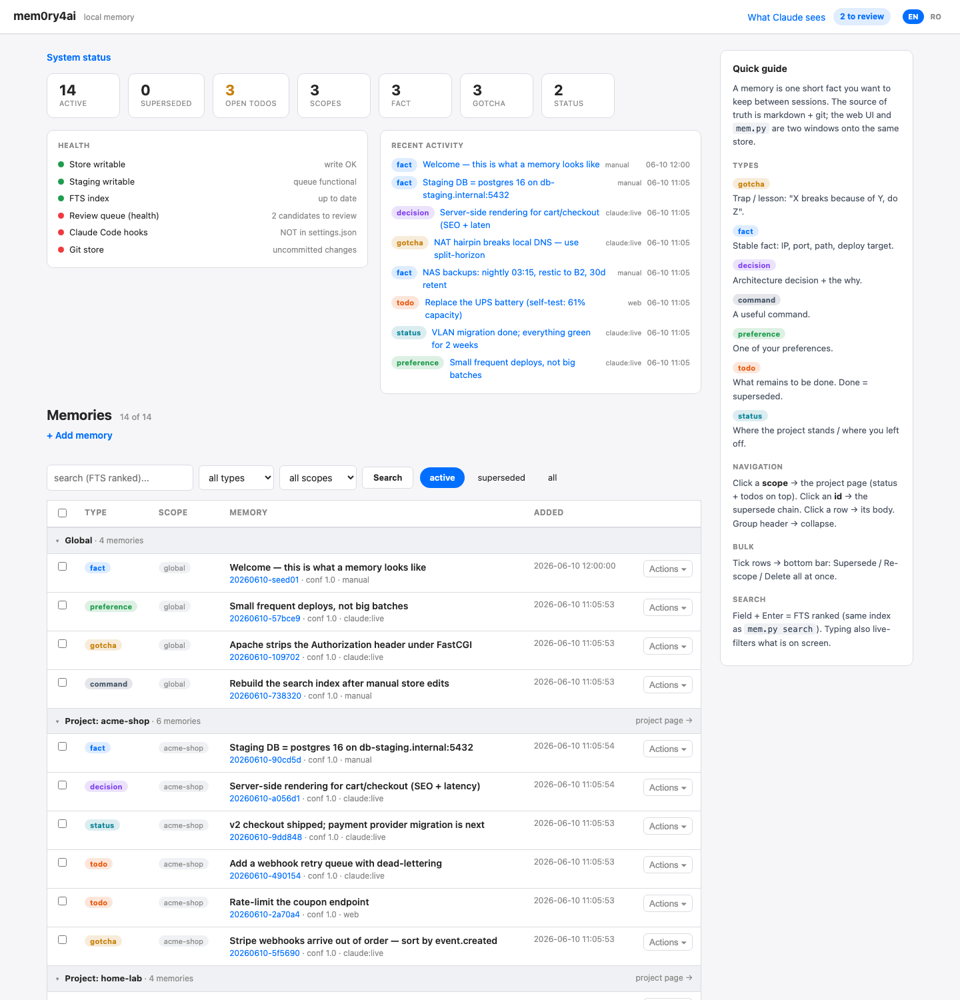
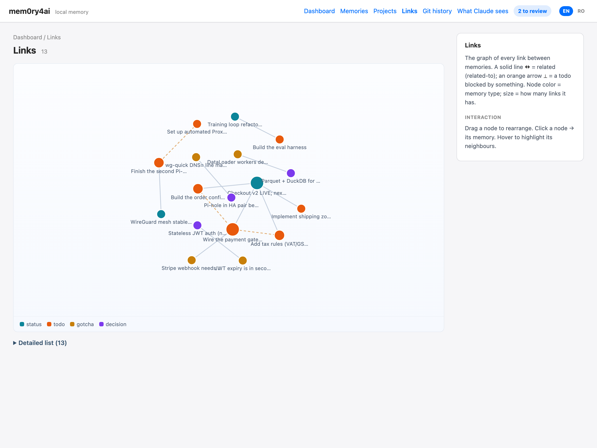
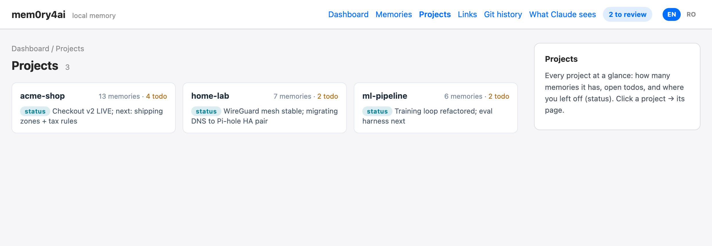
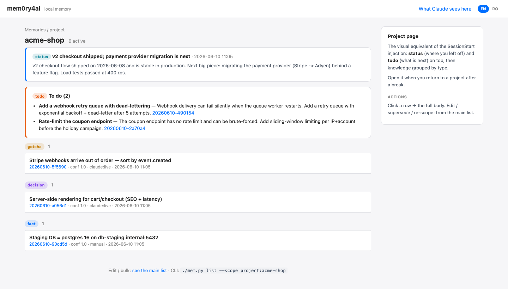
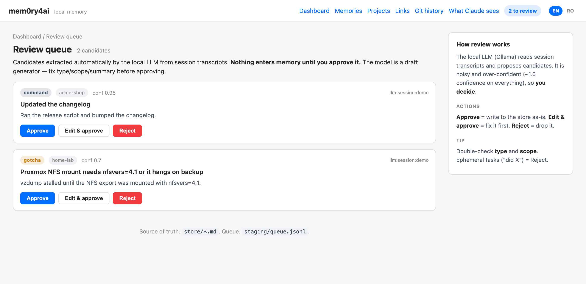
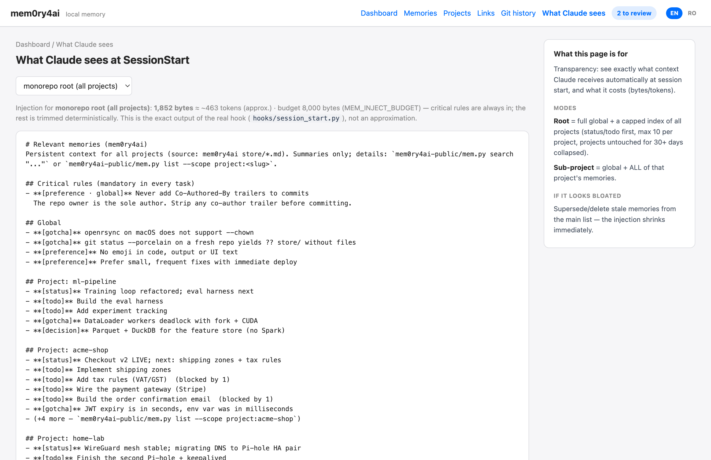
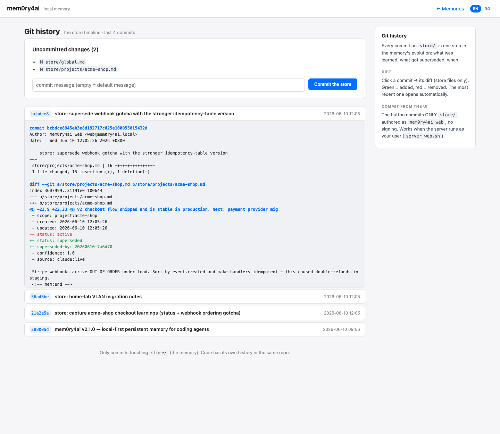

# mem0ry4ai

[](https://github.com/cremenescu/mem0ry4ai/blob/main/LICENSE)
[](https://github.com/cremenescu/mem0ry4ai/releases/latest)
[](#use-from-any-agent-mcp)
[](https://tensorblock.co/mcp/servers/github-cremenescu-mem0ry4ai-053d1f06)

Persistent, local-first memory for coding agents — built for [Claude Code](https://claude.com/claude-code), usable from **any MCP client** (Gemini CLI, Cursor, OpenCode…).


*One session saves a lesson; a later one asks in plain words and gets it back — then picks the project up where it stopped. (Reproduce it: `./demo/seed-demo-store.sh && ./demo/demo.sh`.)*

**Works with:** Claude Code · Gemini CLI · Cursor · OpenCode — any MCP client.
**Landing page:** [cremenescu.ro/en/mem0ry4ai](https://cremenescu.ro/en/mem0ry4ai/)

Your agent forgets everything between sessions. mem0ry4ai fixes that: it captures durable
knowledge (gotchas, decisions, facts, commands, preferences, todos, project status), stores it
in **plain markdown versioned by git**, and delivers the relevant slice two ways — **pushed
automatically** into every Claude Code session via hooks, and **pulled on demand** by any other
agent through a built-in **MCP server** — always scoped to the project you are working in.

## Why another memory tool?

We surveyed the landscape first (claude-mem, basic-memory, mem0, Letta/MemGPT, Graphiti,
agentmemory, the official MCP memory server). Recurring failure modes shaped this design:

| Common failure | mem0ry4ai answer |
|---|---|
| Model forgets to call save/recall tools | **Deterministic hooks** push memory at session start, on the prompt, and the first time a session touches a project or a file; the agent is *instructed* to write proactively |
| Vector DB fragility (Chroma/Qdrant = #1 source of real bug reports) | **Markdown + git is the source of truth**; SQLite FTS5 index is *derived and disposable* |
| Memory rots (stale facts, contradictions) | **Supersede, never delete** — old records keep history; git keeps everything |
| Auto-extraction noise (small LLMs are over-confident: ~1.0 confidence on everything — we measured) | **Trust-gated writes**: the in-context agent writes directly; batch LLM extraction goes through a human review queue |
| Tools that vandalize CLAUDE.md / fight native memory | Coexists cleanly — own namespace, never touches your files |
| Nobody remembers "where was I?" on returning to a project | First-class **`todo`** and **`status`** types, pinned in injection and UI |
| Credentials accumulate in an unencrypted memory file | **Secret redaction on every write path** (8 patterns: API keys, Bearer/GitHub/OpenAI/Slack tokens, AWS keys, private keys, passwords) + `mem.py audit` for what is already stored |
| As memory grows, the injection grows — and the harness truncates it blindly, silently dropping rules the agent must follow | **Self-budgeted injection**: `priority: critical` rules are always in (first, full body); the rest fills `MEM_INJECT_BUDGET`; every cut is announced with the command that retrieves it |

## Measured impact (author's real setup)

This is not a synthetic benchmark — it is the author's actual monorepo (30 sub-projects), before
and after migrating a monolithic `CLAUDE.md` into mem0ry4ai (217 active memories):

| | Before (one big CLAUDE.md) | After (slim CLAUDE.md + injection) |
|---|---|---|
| Fixed context loaded at **every** session start | 242,956 bytes (1,832 lines) ≈ ~61k tokens | repo root: 29,169 bytes ≈ ~7.3k tokens · sub-project: 19,044 bytes ≈ ~4.8k tokens |
| Reduction | — | **88%** (root) / **92%** (sub-project) |
| Relevance | everything, everywhere (FreeRDP gotchas while editing a weather app) | scoped: global + the current project; `status`/`todo` first |
| SessionStart hook overhead | — | 69 ms |
| Live-update poll (no changes) | — | ~1–4 ms |

At the author's measured pace (34 session starts/day) that is roughly **1.8M tokens/day of
context that no longer gets loaded** — while recall got *better*, because memories are scoped,
ranked-searchable and pinned by relevance instead of buried in a 240KB file.

*Honest caveats: tokens estimated at ~4 chars/token; with prompt caching the billed savings are
smaller than the raw numbers; this is one user's setup, not a controlled study.*

## How it works

```
Claude Code session
  ├─ SessionStart hook ─► injects relevant memories (global + current project;
  │                       from a monorepo root: a capped index of ALL projects)
  ├─ UserPromptSubmit hook ─► the few memories a prompt's own words point at
  ├─ PostToolUse hook ─► the first time the session works in a project: its brief;
  │                      the first time it touches a file: the memories anchored to it
  ├─ [work] the agent proactively writes durable findings ─► mem.py add
  └─ SessionEnd + PreCompact hook ─► transcript pointer to staging/ + auto-commit of the store +
                                    auto-embed of new memories, at EACH boundary (end-of-session and
                                    mid-session before compaction) — nothing is lost when context
                                    compresses without warning; no manual chore

store/*.md   ◄── SOURCE OF TRUTH (markdown + git: audit, diff, rollback, supersede)
   ├─► store/.index.db   (FTS5, ranked search — derived, regenerable)
   ├─► web UI            (dashboard, per-project "where was I" page, review queue, live updates)
   ├─► mem.py            (CLI: add/list/search/supersede/ready/resume/link/embed/... — stdlib only)
   └─► mem.py mcp        (MCP server — ANY agent pulls on demand: Gemini CLI, Cursor, OpenCode, …)
```

## What the agent gets, and when

Session start is the wrong moment to decide what a session will need: all it knows is the working
directory. So memory is pushed at several moments, each keyed on something the session has
actually done:

| Moment | What is added to the context | Switch |
|---|---|---|
| Session start — and again after compaction or `/clear` | your profile, the critical rules, the digests marked `always`, then an index of memories (global + the current project) | — |
| A prompt | the few memories its own words point at, one line each | `MEM_PROMPT_RECALL` |
| The first tool call inside a project | that project's **brief** | `MEM_BRIEF` |
| The first touch of a file | the memories **anchored** to it (`files:`) | `MEM_FILE_RECALL` |
| A file or a command a digest was written for | that **digest** | `MEM_DIGEST` |

All of this writes into the context unasked, so three rules hold everywhere:

- **Once.** A brief, a file's memories and a digest are given once per session, and whatever the
  session was already shown is left out of what comes later. After compaction or `/clear` the
  context is gone, so they may come again. A subagent is counted apart from the session that
  started it.
- **Visible.** Each push also prints one line for *you* — at start how much was loaded, afterwards
  which memories and from which project — so a wrong recall is something you see, not something
  the model quietly carries. `MEM_RECALL_NOTICE=0` drops the line and keeps the recall.
- **Silent when unsure.** Most prompts and nearly every tool call add nothing, and any error in
  the prompt and tool hooks ends in exit 0 with no output: a prompt must never fail to send, nor a
  tool call fail, over a memory.

Every one of them goes through the same `emit_for` choke point as the rest
([Egress tiers](#egress-tiers--what-a-memory-may-tell-a-model)), so a `private` memory is in none.

### Recall on the prompt

The working directory says little when sessions start at a monorepo root; the prompt says a lot:
"do it like in billing-api", "it goes through the bastion", "we solved this before". The
`UserPromptSubmit` hook looks the prompt's own words up in the full-text index and offers at most
`MEM_PROMPT_MAX` memories, one line each (id, type, project, summary); the agent opens the ones it
needs with `mem.py get <id>`.

It is keyword-only on purpose — it runs on every prompt and must work with no embedder — and it
prefers silence to a guess. A memory is offered only when at least two words that are *rare in
your store* match its title; one, plus a second match anywhere, is enough when the prompt itself
says a memory is expected ("as before", "we already…") or names that memory's project. Which rare
words are talk rather than topic is learned from your own prompts: a word that turns up across a
large share of your sessions stops counting. `python3 recall.py learn` warms that table from the
transcripts already on disk. Slash commands, the turns the harness starts by itself and prompts
shorter than `MEM_PROMPT_MIN_CHARS` are skipped.

```bash
python3 recall.py "the ledger import fails on the second batch"   # what this prompt would bring; logs nothing
```

### Project briefs and anchored memories

On a monorepo most sessions start at the root, where "the current project" means nothing. The
brief waits until the session shows where it works: the first time a tool call names a path inside
a project — a file read or edited, a search, a shell command's working directory or the paths it
names — the agent is given that project's latest status, the todos nothing blocks, its
preferences, and the knowledge that has been opened most in recent months. A command that walks
several projects at once (`du -sh a b c`) briefs nobody.

A project is a top-level folder, beside the others, that has memories under `project:<folder>`;
when a folder and its scope are named differently, `MEM_SCOPE_ALIASES=folder=slug, other=slug`
maps them. A prompt that names a project in full ("continue with billing-api") brings its brief
before any tool runs. "Do it like in billing-api" does not: that is a reference, not the place of
the work.

The first touch of a file brings the newest memories whose `files:` names it, with a pointer to
the rest (`mem.py list --files <path>`). Inside its own project an anchor may be a bare file name;
from another scope, `global` included, it has to spell the path from the root.

```bash
python3 brief.py billing-api                           # the brief that project would get; marks and logs nothing
python3 brief.py --file /path/to/billing-api/src/auth.py   # what touching this file would bring
```

**One limit to know about.** "The folder that holds the projects" is the parent of the data
directory. In a git-clone install the data sits in the clone, so the projects are the clone's
siblings — the monorepo layout this was built for. In a plugin install the data sits in
`~/.mem0ry4ai`, so that folder is your home directory, and a project at `~/code/web-shop` is not a
top-level folder of it: it gets no first-touch brief. Put the data next to the projects instead —
move `~/.mem0ry4ai` to `~/code/.mem0ry4ai` and set `MEM_DATA_DIR` to it in the environment Claude
Code runs in. Session start is not affected either way: started inside a project's folder, it
loads that project's memories.

### Digests — standing preferences, delivered at their moment

Preferences pile up as dozens of small memories, far more than a start list has room for, and the
ones about, say, git only matter when a commit is about to happen. A **digest** is one page that
distils a theme, each line citing the memories it comes from. The memories stay the source; the
digest is the form in which they reach the agent. Any record with a `when:` line is one — by
convention a `procedural` titled "Digest: <theme>" — and `when:` says at which moment it is given:

| `when:` clause | The digest is given |
|---|---|
| `always` | at every session start, whole, under "House rules" |
| `paths=*.css, */design/*` | the first time a tool touches a path the glob matches (the path is taken from the folder that holds the projects) |
| `commands=git (commit\|push)` | the first time a shell command matches the regex |

Clauses are joined with `;` (a literal `;` inside a regex is written `\x3b`). A digest in `global`
is for every session; one in a project only for work in that project. An unknown clause or a regex
that does not compile is refused when the digest is written, not discovered when it never fires.
An `always` digest that has outgrown its part of the start injection is not cut: a note takes its
place, saying it no longer fits.

```bash
./mem.py add --working --type procedural --scope global \
    --summary "Digest: Git and releases" --when "commands=git (commit|push|tag)" \
    --digest-of "<id>, <id>" --body "- one distilled line per rule [<id>]"
./mem.py digest                      # every digest: draft or active, its moment, sources retired or rewritten since
./mem.py digest --verbose            # ... and the preferences no digest cites yet
./mem.py promote <id>                # a draft is given to nobody until it is promoted
```

Written with `--working`, a digest is a draft: it sits on the **Working notes** page and reaches
no session until promoted. Leave `--working` out and it is active at once. Nothing in the code
stops an agent from promoting a draft — that a person reads the page first is a convention you
keep, not a lock.

### Measuring it

Whether any of this helps is a question with a number, so the hooks keep count — in
`store/.access.db`, a local database that is git-ignored and sent nowhere:

- which memory ids were pushed, at which moment, and which ones the agent then went and opened;
- the agent's own search queries, secret-redacted and cut short (`MEM_SEARCH_LOG=0` turns this off);
- for each prompt: its length, how many candidates it had and what happened — **never its text**;
- which words *that already occur in the store* a session's prompts used, which is what tells talk
  from topic.

```bash
python3 recall.py eval --build       # pick a benchmark from your own transcripts, once
python3 recall.py eval               # score the per-prompt recall on it
```

The benchmark needs no labelling. A *lookup* is a prompt after which the agent opened a memory
that already existed — its own next move says the memory was needed. A *quiet* prompt is one after
which it opened nothing. The report gives two numbers that pull against each other: how often the
recall would have offered the memory before the agent had to look for it, and how often it stays
silent when nothing was needed. A change that raises the first by lowering the second has only
become louder. The benchmark file holds pointers (transcript, message id, memory ids), never a
prompt's text, and is written to `eval/` in the data directory.

**If your data directory was created before 0.21.0** by a plugin install or through `MEM_DATA_DIR`,
its `.gitignore` names the derived databases one by one and misses the access log, so the
session-end checkpoint has been committing `store/.access.db` to that local repository. New data
directories ignore every database under `store/`; an existing one is left as it is, and three
lines fix it (shown for the plugin's `~/.mem0ry4ai`):

```bash
cd ~/.mem0ry4ai
echo 'store/.*.db*' >> .gitignore
git rm --cached store/.access.db && git commit -m "stop tracking the access log"
```

### Keeping the start list honest

A project's `status` is the first thing a returning session reads, and a status nobody has touched
in months is the one most likely to be wrong. One untouched for `MEM_INJECT_STATUS_DAYS` is left
out of the start list — not retired: it stays active and searchable, the list says how many were
left out, and the project you started in always shows its own. `mem.py stale` lists them, and
`mem.py stale --keep <id>` says "still true" for one. Titles in the start list are cut at
`MEM_INJECT_TITLE` characters; the full text is one `mem.py get` away.

## Use from any agent (MCP)

mem0ry4ai works with **any MCP-capable agent**, not just Claude Code. The Claude Code hooks **push**
memory into the session automatically; every other runtime — **Gemini CLI, Cursor, OpenCode, Claude
Desktop** — **pulls** it on demand from a built-in **MCP server**:

```bash
python3 mem.py mcp        # stdio JSON-RPC server (Windows: py mem.py mcp)
```

It exposes eight tools — `memory_search`, `memory_get`, `memory_list`, `memory_resume`, `memory_add`
(which takes `supersedes` to retire the memory it revises, and `files` to anchor it to code),
`memory_note` / `memory_promote` (working memory, below), and `session_search` (past-conversation
search, below). It's a hand-rolled stdio server — still **pure stdlib, no SDK, no `pip install`**.
Register it:

It also serves **resources** and **prompts**, not only tools. A tool is a pull the *model* has to
decide to make; a resource or a prompt is a surface the *client* drives, which is the supported way
to get context in before the first turn:

| Kind | Name | What it gives you |
|---|---|---|
| resource | `mem0ry4ai://essentials` | your profile + every critical rule — attach it at the start of a conversation |
| resource | `mem0ry4ai://resume` | latest status, open todos, recent knowledge (all scopes) |
| template | `mem0ry4ai://resume/{scope}` | the same for one project, e.g. `mem0ry4ai://resume/project:api` |
| prompt | `recall` | pulls the memories relevant to a question into the conversation |
| prompt | `resume` | loads the "where was I" briefing for a project |

```bash
# Claude Code
claude mcp add mem0ry4ai -- python3 /absolute/path/to/mem.py mcp
```
```jsonc
// or a .mcp.json (Cursor / Claude Desktop / others)
{ "mcpServers": { "mem0ry4ai": { "command": "python3", "args": ["/absolute/path/to/mem.py", "mcp"] } } }
```

On connect the server sends its usage guide (`MEM0RY4AI.md`) as the MCP `instructions`, so the agent
knows to search before answering and how to save — **without touching your `CLAUDE.md`**. If you
*want* a pointer there, add one line yourself (optional): `Memory: use the mem0ry4ai MCP tools; see
MEM0RY4AI.md`.

**Push for hook-less agents.** For agents that have no SessionStart hook (Gemini/Antigravity, Cursor, …)
the `instructions` also carry your **global essentials — the user profile and every critical rule —
straight from the store**, so the must-haves are present before the model's first turn, not left to a
tool call (the same guarantee the Claude Code hook gives). Project context stays a `memory_resume` /
`memory_search` pull (at `initialize` the server doesn't yet know the project). Claude Code already gets
these from its hook, so the push is skipped there — **but you can still add the MCP to Claude Code** for
the pull tools (fragment refs, working memory, fine-grained search) alongside the hook.

`memory_add` (write) is **on by default**; set `MEM_MCP_WRITE=0` to make the server read-only. With
several agents writing to one store, have them `memory_search` before `memory_add` to avoid
duplicates (writes are serialized by a file lock and secret-redacted regardless).

**Working memory.** `memory_note` jots a *scratch* note (status `working`): **not** injected at session
start and hidden from search/recall, so tentative findings during a long task don't pollute the durable
store. `memory_promote` flips the keepers to a durable memory; review them on the web UI's **Working
notes** page or with `mem.py list --status working`. (CLI: `mem.py add --working`, `mem.py promote <id>`.)

**Session search.** `memory_search` searches the *distilled* store; `session_search` searches your **raw
conversation history** instead — "what did we actually discuss weeks ago?" — over a derived FTS5 index of
the Claude Code transcripts, at zero LLM cost. Secrets are stripped before indexing and the index is
owner-only, gitignored, and never leaves your machine. (CLI: `mem.py sessions "<query>"`, `--list`,
`--reindex`, `--project <name>`.)

**Fragment refs.** `memory_get` shows a record's body with 1-based line numbers; pass `"<id>:5-9"` (or a
`lines` arg) to retrieve just those lines and cite a precise line of a longer memory. (CLI: `mem.py get
<id>:5-9`.)

**Hygiene & housekeeping (v0.16).** As the store grows: `mem.py consolidate` clusters near-duplicate
memories and writes the merge proposals to a `mem-consolidation` git branch you review with `git diff`
(never auto-merged); `mem_maintenance.py install` schedules that plus reindex/re-embed and stale
working-note cleanup as a local launchd job (non-destructive by default). Memories carry a `session:`
provenance stamp (which conversation produced them) and an optional `protected:` flag that blocks
in-place edits, and injection at session start honours a per-record body cap. Any non-MCP agent or
script can `POST /api/propose` JSON to drop a memory into the human review queue.

## Quick start

Requirements: **Python 3.9+ and git — that's it.** No PHP, no Docker, no vector database, no API
keys, no `pip install`. The CLI, the hooks, and the web UI are all pure-Python stdlib, so it runs
the same on **macOS, Linux, and Windows**.

### Option A — Claude Code plugin (one command)

```bash
claude plugin marketplace add cremenescu/mem0ry4ai
claude plugin install mem0ry4ai@mem0ry4ai
```

Restart Claude Code — hooks (inject at start, recall on the prompt and at the first touch of a
project or a file, capture + git checkpoint at end) register automatically and the web UI starts
with your first session. In plugin installs your data
lives in **`~/.mem0ry4ai`** (its own git repo, created on first write), so plugin updates
never touch your memories. The injected context header shows the exact `mem.py` path to
use from inside a session. (First-touch project briefs look for projects next to the data
directory — see [the one limit](#project-briefs-and-anchored-memories) if yours live elsewhere.)

### Option B — git clone (data stays in your clone)

```bash
git clone https://github.com/cremenescu/mem0ry4ai.git
cd mem0ry4ai

# 1. CLI works immediately
./mem.py add --type gotcha --scope global \
  --summary "openrsync on macOS does not support --chown" \
  --body "Use --rsync-path=\"sudo rsync\" and chown separately over ssh."
./mem.py list
./mem.py search "rsync"                    # FTS5 ranked
./mem.py search "rsync" --since 2026-05-01 # ...only memories created since May
./mem.py audit                             # report secret-like patterns (read-only)

# 2. Web UI (pure-Python stdlib server — no PHP, no Apache)
./mem.py serve                    # -> http://127.0.0.1:8841/  (Windows: py mem.py serve)

# 3. Claude Code integration (hooks: inject at start, recall on the prompt and at the
#    first touch of a project or file, capture at end)
python3 hooks/install.py --dry-run        # preview what would be written
python3 hooks/install.py --target user    # ~/.claude/settings.json (all projects)
# restart Claude Code (or /clear) to load the hooks
```

Two of the hooks run often — one on every prompt, one after every file, search or shell tool call
— and each can be left out at install time: `--no-prompt-recall`, `--no-tool-recall`. Installed,
they can still be switched off without touching the registration (`MEM_PROMPT_RECALL=0`,
`MEM_BRIEF=0`, `MEM_FILE_RECALL=0`, `MEM_DIGEST=0`).

After updating a clone to a new version, run `hooks/install.py` again: it replaces its own entries
instead of adding to them, and it is what registers the hooks a new version brings (in 0.21.0 the
prompt and tool hooks, and a session start split in four parts). A plugin install reads them from
the plugin's own `hooks/hooks.json`.

The SessionStart hook also auto-starts the web server, so the UI is always up while you work.

### Windows (native — no WSL, no PHP)

Everything is pure-Python stdlib, so mem0ry4ai runs natively on Windows. There is a graphical
installer that does the whole thing — it installs Python and git through winget if they are
missing (per-user, never as administrator), clones, puts the store outside the clone, registers
the hooks, and sets `CLAUDE_CODE_GIT_BASH_PATH`, without which the hooks register and then
silently never fire:

```powershell
powershell -ExecutionPolicy Bypass -File install-windows.ps1
```

It echoes every command into its log before running it, and its second tab uninstalls. Or do it
by hand with `py` (or `python`):

```powershell
git clone https://github.com/cremenescu/mem0ry4ai.git
cd mem0ry4ai
py mem.py add --type gotcha --scope global --summary "..." --body "..."
py hooks\install.py --target user      # registers the hooks with YOUR interpreter
py mem.py serve                        # web UI at http://127.0.0.1:8841/
```

`hooks\install.py` records the hook commands using your Python interpreter (`sys.executable`), so
the SessionStart/SessionEnd hooks run on Windows without a `python3` on `PATH`, and the web server
launches the same way. Data lives in `%USERPROFILE%\.mem0ry4ai`. (The plugin-marketplace install
invokes `python3`; on native Windows the clone + `install.py` path above is the most reliable. WSL
also works like plain Linux.)

<details>
<summary><strong>Full Windows walkthrough</strong> — real install transcript (username shown as <code>xxxxx</code>)</summary>

On a clean Windows 11 box with neither Python nor git, install both with `winget`, then
**close and reopen PowerShell** (PATH only refreshes in new windows):

```text
PS C:\WINDOWS\system32> winget install -e --id Python.Python.3.12
Found Python 3.12 [Python.Python.3.12] Version 3.12.10
Successfully installed
PS C:\WINDOWS\system32> winget install -e --id Git.Git
Found Git [Git.Git] Version 2.54.0
Successfully installed

PS C:\WINDOWS\system32> py --version
Python 3.12.10
PS C:\WINDOWS\system32> git --version
git version 2.54.0.windows.1

PS C:\WINDOWS\system32> cd $env:USERPROFILE
PS C:\Users\xxxxx> git clone https://github.com/cremenescu/mem0ry4ai.git
Cloning into 'mem0ry4ai'...
Receiving objects: 100% (368/368), 4.01 MiB | 6.30 MiB/s, done.
Resolving deltas: 100% (211/211), done.
PS C:\Users\xxxxx> cd mem0ry4ai
PS C:\Users\xxxxx\mem0ry4ai> py hooks\install.py --target user
installed in C:\Users\xxxxx/.claude/settings.json
Restart Claude Code (or /clear) so the hooks get loaded.
```

If `winget` is unavailable (older Windows), install Python from python.org — **tick "Add
python.exe to PATH"** — and git from git-scm.com, then continue from the version checks.

**If Claude Code then shows "Git is required for local sessions"** — it was running *before* git
was installed, so it doesn't know where `bash.exe` is. Point it at git-bash and fully restart:

```powershell
# confirm the path (default install location)
Test-Path "C:\Program Files\Git\bin\bash.exe"

# if it returns True:
[Environment]::SetEnvironmentVariable("CLAUDE_CODE_GIT_BASH_PATH", "C:\Program Files\Git\bin\bash.exe", "User")

# if git is installed elsewhere, resolve bash.exe dynamically:
$bash = Join-Path (Split-Path (Split-Path (Get-Command git).Source)) "bin\bash.exe"
[Environment]::SetEnvironmentVariable("CLAUDE_CODE_GIT_BASH_PATH", $bash, "User")
```

Then **close Claude Code completely** (check the system tray and Task Manager — it reads the
variable only at startup) and reopen it. The hooks load on the next session and the web UI comes
up at `http://127.0.0.1:8841/`.

</details>

### Server install (Docker)

For a NAS, a home server, a VM — anything always-on that you want to reach from a browser. It is
**not** the right way to use mem0ry4ai on the machine where you run Claude Code: there the hooks
run inside the Claude Code process, and containerising would turn every SessionStart into a
`docker exec`, adding a daemon to a tool whose whole claim is that it needs none.

```bash
cd docker && docker compose up -d      # http://localhost:8841/
```

If you run it by hand instead of with compose, **`--init` is mandatory**:

```bash
docker run -d --name mem0ry4ai --restart unless-stopped --init \
    -p 127.0.0.1:8841:8841 -v /srv/mem0ry4ai:/data mem0ry4ai
```

Without it, PID 1 in the container is the server itself, which does not reap the orphaned children
it inherits. They accumulate as zombies until the **host** runs out of task slots — on the NAS this
was found on, that meant nothing on the whole machine could fork any more, SSH included. `--init`
puts tini at PID 1, which reaps whatever it inherits regardless of what the application does.
`compose.yaml` sets `init: true` for you.

The store is a mounted volume, never inside the code clone, so updating the image cannot touch
memories and `docker rm` is not a data-loss event. The clone's git remote is removed rather than
left unused — a clone of the public repo sitting next to a store full of private memories is one
`git push` away from publishing them.

Two settings are load-bearing rather than stylistic. `MEM_WEB_HOST=0.0.0.0` is required inside the
container: the server binds loopback by default, and publishing a port to a loopback-bound server
gives you a container that looks healthy and answers nothing. And the compose file publishes to
`127.0.0.1` only — **the web UI has no authentication**, so exposing it beyond the host is a
decision to make on purpose, with a reverse proxy in front. Never expose it to the internet.

### Uninstalling

```bash
python3 uninstall.py          # show exactly what would be removed, change nothing
python3 uninstall.py --yes    # remove the hooks, the scheduled job, the running web server
```

**It does not delete your memories.** That is deliberate: the store is what you spent months
building, the code is a `git clone` away, and an uninstaller that quietly takes the data with it
is a data-loss bug wearing a helpful face. Removing the store needs `--delete-memories` *and*
typing the word DELETE at the prompt.

If your store lives inside the code folder (the git-clone install), the preview says so before you
delete anything — that is the one arrangement where "just remove the directory" also removes every
memory you have.

On Windows the same operations are the second tab of `install-windows.ps1`.

## Memory types

| Type | What it holds |
|---|---|
| `gotcha` | trap + cause + fix ("X breaks because Y, do Z") |
| `decision` | architecture choice + the *why* |
| `fact` | stable infrastructure facts (hosts, paths, ports) |
| `command` | a command you would otherwise look up again |
| `procedural` | a reusable multi-step workflow / runbook (release steps, a recovery drill) |
| `preference` | user style/conventions/corrections |
| `todo` | what remains to be done (supersede when finished) |
| `status` | where the project stands / where you left off |

`todo` + `status` are pinned first in injection and in the per-project web page — they answer
"where was I?" when you return to a project after weeks. The CLI mirrors this: `mem.py resume
--scope project:<slug>` prints a one-screen briefing (latest status + ready/blocked todos + recent
knowledge); with no scope, a one-line-per-project overview.

### Teach your agent to write memories

Add an instruction like this to your `CLAUDE.md` (this is the behavioral half of the system —
hooks handle recall, the agent handles capture):

> When you discover something durable (a gotcha with a non-obvious cause, an architecture
> decision, an infrastructure fact, a reusable command, a user preference/correction, a change
> of project status), proactively save it without asking:
> `echo "body" | <path>/mem.py add --type <T> --scope <global|project:slug> --summary "..." --source claude:live`
> Check `mem.py search` first to avoid duplicates. Never save ephemeral tasks.

`mem.py add` also **warns (never blocks)** when a near-duplicate memory of the same type already
exists — printing the closest matches and a ready-to-run `supersede` command — so overlapping
memories get merged instead of piling up. New memories are **auto-embedded at session end**, so
search and the Links suggestions stay current without running `mem.py embed` by hand.


### Record fields beyond the basics

A few optional fields make records sharper and history honest:

- **`files`** — the paths a memory is about. Derived from the memory's own text on write, keeping
  only paths that resolve to a real file in that project, because optional metadata that has to be
  typed by hand does not get typed (`mem.py backfill-anchors --write` fills in records written
  before). Ask it the other way round with `--files` on `search`/`list`, or `files` on the
  `memory_search` tool — *what do I already know about the file I am about to edit?* Matching is on
  whole path components, never substrings; a trailing slash matches a whole directory. In Claude
  Code the question is asked for you: the first time a session touches an anchored file, its
  memories arrive next to that tool call's result.
- **`when`** / **`digest-of`** — make a record a
  [digest](#digests--standing-preferences-delivered-at-their-moment): the moment it is given, and
  the memories it distils.
- **`mirrored-in`** — on a critical rule whose full text also lives in an instruction file the
  agent always loads (`mem.py mirror <id> CLAUDE.md`): session start then names the rule instead of
  repeating it, while MCP clients, which do not load that file, still get it in full.
- **`distinct-from`** — two memories that read alike and were judged *not* to be duplicates, so
  the pair is not offered again (see [Duplicates](#duplicates)).
- **`tier`** — `open` (default), `redacted` or `private`: what this memory is allowed to tell a
  model. See [Egress tiers](#egress-tiers--what-a-memory-may-tell-a-model).
- **`protected`** — refuse in-place edit, delete and supersede, for the handful of standing rules
  no agent (and no stray click) should rewrite. Opt-in, and since a record is a block in a file you
  own, unsetting it by hand is always available.
- **`session`** — provenance: which conversation produced this memory, so "where did this claim
  come from?" is still answerable months later. Pairs with `session_search`.
- **Bi-temporal supersede** — superseding keeps the old record *and* stamps **when** it stopped
  being true (`invalidated`) and **why** (`invalid-reason`), separately from `created`
  (valid-from). You get the full "what did we believe, and when" history instead of a bare
  tombstone:
  ```bash
  ./mem.py supersede <old-id> --by <new-id> --reason "single Pi-hole was a SPOF; moved to an HA pair"
  ```

## Relations & ready work

Memories can be linked — deliberately, never auto-guessed by keyword (that only produces noise):

- **`related-to`** — connect related memories (a gotcha ↔ the decision that caused it, a status ↔
  its todos). Shown both ways in the web UI as clickable chips.
  ```bash
  ./mem.py link <id> <other-id>...
  ```
- **`blocked-by`** on a `todo` — work that must be done first. **`mem.py ready`** lists the todos
  with no *open* blocker (a blocker is open while it is still an active todo; finishing it =
  superseding it frees the dependents). The injection annotates blocked todos; the per-project
  page splits **ready** vs **blocked**.
  ```bash
  ./mem.py block <todo-id> <blocker-id>...
  ./mem.py ready --scope project:my-app
  ```

The **Links** page in the web UI shows every edge at a glance — a force-directed graph (nodes
colored by type, sized by degree) over the same `related-to` / `blocked-by` data, with a grouped
text list below. No external libraries — a small vanilla-JS + SVG simulation, offline-first.

## Search, ranking & suggestions

Search is keyword-first and works with zero dependencies, but degrades *up* when an embedder is
available — it never *requires* a model:

- **Ranked FTS5 + recency** — `mem.py search` ranks with SQLite bm25, then applies a small recency
  nudge (`MEM_RECENCY_WEIGHT`) so that among near-ties the fresher memory wins, without ever
  overriding a clearly stronger keyword match.
- **Optional hybrid semantic search** — if [Ollama](https://ollama.com) is running with an embedding
  model (`bge-m3`, ~1.2 GB), search fuses keyword scores with cosine similarity over locally-stored
  vectors, so "auth token expiry" can find a memory that says "JWT TTL" — and it
  surfaces semantic matches even when *nothing* keyword-matches. The embedder is **retrieval-only**:
  it turns text into vectors to *compare*, it never decides what is a memory and never writes — so it
  stays clear of the trust gate. No Ollama → automatic, silent fallback to keyword-only.
  ```bash
  ollama pull bge-m3
  ./mem.py embed          # build/refresh vectors (incremental, by content hash) -> store/.embed.db
  ./mem.py search "auth token expiry"   # prints "# search mode: hybrid (FTS + semantic)"; --no-semantic forces keyword
  ```
  `bge-m3` is the default because it is **multilingual**: on a mixed Romanian/English store the
  English-centric `all-minilm` (~45 MB) was effectively blind to non-English paraphrases — median
  retrieval rank 1 versus 231. If your memories are English-only, `MEM_EMBED_MODEL=all-minilm` is
  40× smaller and works fine. Measure before you switch: `tools/bench_recall.py` (below) exists
  precisely so this is a number rather than an opinion.
  No toggle to remember: the Memories page **auto-detects** the embedder and shows a status light —
  **green** = the local LLM is up, so search is keyword + semantic; **gray** = it fell back to classic
  keyword search (with the reason on hover). The dashboard health panel reports the embedder too.
- **Link suggestions** — on the **Links** page, the closest *unlinked* memory pairs (by cosine over
  the same vectors) are offered as suggested `related-to` edges. You **confirm or dismiss** each one
  — nothing is linked automatically. It is computed from the stored vectors (no live model at page
  load); dismissed pairs stay dismissed.

Vectors live in their own derived file (`store/.embed.db`), separate from the text index and never
the source of truth — delete it any time and `mem.py embed` rebuilds it.

## Duplicates

The add-time warning catches a duplicate as it is being written; this finds the ones already in
the store. `mem.py dups`, and the **Duplicates** page of the web UI, group *active* memories of the
same type that are at least `MEM_DUPS_THRESHOLD` alike, the most alike first. A chain is one
group: five versions of one gotcha come out as a group of five, not as ten pairs. Likeness comes
from the vectors `mem.py embed` builds, so with no vectors there is nothing to compare, and the
command says so.

Left out on purpose: retired memories, working notes, digests (they repeat their sources by
design), memories of different types, and pairs already marked `distinct-from`.

```bash
./mem.py dups                                  # the groups
./mem.py dups --keep <id> --retire <id> <id>   # one stays, its copies are retired in its favour
./mem.py dups --distinct <id> <id>             # they read alike and are not the same thing
./mem.py dups --undo <kept-id>                 # take that back: the copies are active again
```

Retiring is a supersede, so nothing is deleted. Each copy is stamped `invalid-reason: duplicate of
<id>`, and what pointed at it — links, blockers and, within the same scope, file anchors — moves
to the one that stays. It happens whole or not at all, and it refuses to retire a `protected`
memory, or a critical rule in favour of an ordinary one. The page takes one group at a time, from
the keyboard: `J`/`K` move between groups, `S` changes which memory stays, `Enter` retires the
others, `N` marks them not duplicates, `E` opens the one that stays for editing first — and every
retirement has an **Undo**.

## Critical rules and the injection budget

A memory system has a failure mode nobody talks about: **the more it remembers, the longer the
injected context gets — until the harness starts truncating it, blindly**. Claude Code persists
oversized hook output to a file and shows the model only a small preview; whatever falls past
the cut is invisible, and the model cannot follow a rule it cannot see. We hit this in
production: a "never add Co-Authored-By to commits" preference fell past the cut and the agent
violated it.

The fix is that **the injection trims itself, deterministically, before the harness ever has
to**:

- **`priority: critical`** — pin the rules that gate the agent's actions ("never X in commits",
  "never touch production", "always test on one device first"):
  ```bash
  ./mem.py pin <id>            # or: ./mem.py add ... --critical
  ```
  Critical rules are injected **always, first, with their full body**, regardless of budget.
- **Four hooks, not one.** Claude Code caps the output of each hook separately, so session start
  is registered as four — your profile, the critical rules, the `always` digests, the index of
  memories — and each part keeps itself under its own limit. A long profile can no longer push a
  rule past the cut. If the rules together outgrow their part, the longest give way first and the
  injection says so in a line the dashboard's health check turns red on: shorten one, unpin one,
  or mark one as mirrored (`mem.py mirror <id> CLAUDE.md` — a rule whose full text already sits in
  a file the agent always loads is then named instead of repeated).
- **`MEM_INJECT_BUDGET`** (default 8000 bytes) — everything else fills the budget in relevance
  order (current project's status/todo first, then global knowledge, then recently-touched
  projects), and **every cut is announced** in the injection itself:
  `(+12 omitted by budget — mem.py list --scope ...)`. Nothing disappears silently.
- The dashboard health panel shows the real injection size vs the budget, and the
  "What Claude sees" page renders exactly what the agent gets.

## Secret redaction

The store is plain markdown versioned by git — a credential that lands there is hard to remove
retroactively (it survives in git history). So **every write path redacts secrets by default**,
replacing values with `[REDACTED:<label>]`:

- `mem.py add` / `mem.py propose` — the saved memory keeps *what kind* of secret was used
  ("the command used a Bearer token"), never the value.
- `consolidate.py` — transcripts routinely contain `.env` reads, curl headers and passwords;
  they are redacted **before** the text even reaches the local LLM, and candidates are
  redacted again before queueing.
- `mem.py audit` — read-only report of secret-like patterns already in the store (exit 1 if
  any found, handy in CI). It never modifies records — you decide what to clean up.

Patterns: generic API/secret/access keys, Bearer tokens, AWS keys, private key blocks,
quoted passwords, GitHub/OpenAI/Slack tokens. Opt out per call with `--no-redact`, or
globally with `MEM_REDACT=0`. Infrastructure facts you store on purpose (hosts, paths,
ports, usernames) are not touched — only credential-shaped values are.

For secrets the agent should be able to *use* across sessions, store a **pointer, not the
value**: keep the secret in your OS keychain / password manager, and save a `fact` telling
the agent where it lives and a `command` that fetches it at use time.

## Egress tiers — what a memory may tell a model

Redaction catches what *looks* like a secret. It cannot know that a client's name, a salary or a
home address must not be handed to a model: nothing about those strings is suspicious. A tier is
**stated rather than inferred**, so unlike a pattern it has no false negatives.

| Tier | What reaches an agent | What you still see |
|---|---|---|
| `open` (default) | everything | everything |
| `redacted` | the summary only | everything |
| `private` | nothing — the record is absent | everything: search, `mem.py get`, the web UI |

```bash
./mem.py add --type fact --scope project:acme --tier private \
  --summary "who signs off on the migration" --body "..."
./mem.py tier <id> private        # reclassify an existing memory
```

One function decides — `emit_for(record, destination)` in `mem.py` — and **every** surface that
feeds a model goes through it: the SessionStart injection (`mem.py list --dest agent`), the MCP
tools, and the MCP resources and prompts. That is the point: "a private memory never reaches an
agent" is a property of one function you can read start to finish, not a convention four files have
to remember. The web UI labels anything that is not `open`, because a classification you cannot see
is one you cannot trust.

Not claimed: this is not encryption, and it does not defend against someone who can read your disk.
It defends against the thing that actually happens — a memory you did not think about being handed
to a model along with everything else.

## Tests

```bash
python3 tests/test_guards.py             # 400 checks, isolated store, stdlib only
python3 tests/test_guards.py --canary    # remove each guard in turn; the suite must notice
tools/crawl_ui.py http://127.0.0.1:8841  # reachability, broken links, URL state — no LLM needed
```

The suite covers the rules that must not quietly break: secret redaction (each pattern is fed
something it *must* catch), the injection scan, record-delimiter forgery, the one-live-`status`
invariant, `protected`, egress across every surface, what each hook pushes and when it must stay
silent, the duplicate groups and their undo, and — after that class of bug shipped three times —
that no link in the web UI drops the filters you are looking at.

`--canary` is the part worth stealing. It deletes each guard from a scratch copy and requires the
suite to go red — because a check that passes while the thing it checks is gone reports green and
protects nothing. It earned its keep on the first run: the egress test for `memory_get` passed with
the guard removed, because a branch below it happened to swallow the record anyway. The test proved
nothing about the rule it was written for.

## Benchmarking recall

Ranking changes are easy to argue and hard to verify. `tools/bench_recall.py` turns them into a
number: it seeds a throwaway store from a fixture, asks paraphrased questions whose answer is known,
and reports where the intended record landed. **No LLM judge** — the expected id is written down, so
the score cannot drift with a model's mood.

```bash
tools/bench_recall.py                     # fixture store: keyword vs hybrid
tools/bench_recall.py --no-semantic       # keyword only, no embedder needed
tools/bench_recall.py --fixture mine.json --store ~/.mem0ry4ai --min-mrr 0.7
```

On the bundled fixture (14 memories, 48 queries, English + Romanian): keyword `R@1 0.500 / MRR
0.641`, hybrid with bge-m3 `R@1 0.750 / R@5 0.958 / R@10 1.000 / MRR 0.848`.

`mem.py drift` is the companion for the other direction: memories anchored to files (`files:`)
whose files have since gone missing, moved, or been committed to many times are reported as worth
re-reading. It reads no code and judges no memory — it produces a reason to look, never an edit.
The web dashboard surfaces the count and links to the list, and each row there says which file
moved and how, because the answer depends on it.

Churn is counted from when the memory was last *touched*, not when it was written. That is what
makes the report clearable: commits only accumulate, so counting from the creation date would
report an old memory about an active file forever, with nothing the reader could do to clear it.
Re-anchoring is therefore the "I checked, it still holds" gesture the report would otherwise have
no way to accept.

There are only three outcomes, and `mem.py anchor` covers two of them:

```bash
mem.py anchor <id> "src/auth/jwt.ts, src/auth/middleware.ts"   # the lesson holds, the path moved
mem.py anchor <id> -                                           # it was never about those files
mem.py supersede <id> --reason "..."                           # the lesson died with the code
```

Revising a memory rather than retiring it — `mem.py add ... --supersedes <id>`, or `supersedes` on
the `memory_add` tool — carries its `related-to` and `blocked-by` edges to the successor. Without
that the graph degrades on every revision, and it degrades *invisibly*: the edge stays on the
retired record, so a link looks intact while the live memory has none.

**Read the caveat before you tune anything with it.** A 14-memory fixture measures *ordering* — the
answer is already in the candidate set — not *discrimination*. Sweeping the dense retriever's weight
(`MEM_RRF_W_DENSE`) on it showed a clean monotone win, `R@1 0.785 → 0.896`, that **did not exist**
on a real 799-record store: flat at 0.55, no trend from 1× to 10×. That is why the default weight is
still 1.0. Use the fixture to catch regressions; decide ranking parameters with `--store` against a
store of realistic size.

## Web UI

Bilingual (English default, Romanian via the EN/RO switch in the top bar).



*The **Links** page — semantic **suggested links** (closest unlinked pairs, each confirmed or dismissed by hand) above a force-directed graph of every `related-to` / `blocked-by` edge (nodes colored by type, sized by degree; related solid, blocked dashed with an arrow):*



*Projects — every project at a glance: memory count, open todos, current status:*



*Per-project "where was I?" page — status and todos (ready vs blocked) pinned first:*



*The review queue — the over-confident junk candidate (conf 0.95 for "updated the changelog") is exactly why nothing auto-writes:*



*"What Claude sees" — the exact SessionStart injection, with its cost:*



*Git history — the memory timeline with per-commit diffs and commit-from-UI:*



*(Screenshots use demo data.)*

- **Dashboard** (`/`): stat cards (each deep-links into the list with a filter), health
  checks (store/staging/index/queue/hooks/git/injection size), recent activity, live updates via
  cheap polling (~4 ms when nothing changed). Consistent top nav + breadcrumbs on every page.
- **Memories list** (`/memories`): ranked search (same FTS5 index as the CLI),
  grouped/sortable/filterable table, bulk operations (supersede / re-scope / delete),
  supersede-chain navigation; related/blocked links shown on each record.
- **Projects** (`/projects`): every project at a glance — active count, open todos, current
  status — each card opening its per-project page (status + ready/blocked todos pinned first).
- **Links** (`/links`): semantic suggested links (confirm/dismiss) above a force-directed graph
  of all `related-to` / `blocked-by` edges (dependency-free SVG) + a grouped text list — see how
  memories connect at a glance.
- **Duplicates** (`/duplicates`): groups of memories that say the same thing, one group at a
  time, with keep / retire / not-duplicates and an undo — see [Duplicates](#duplicates).
- **Working notes** (`/working`): scratch notes and digest drafts, each with Promote and Dismiss.
- **"What Claude sees"**: renders the exact SessionStart injection, part by part, each with its
  size against the per-hook limit.
- **Settings** (`/settings`): the switches from [Configuration](#configuration) as a form, saved to
  `.mem-local.env` in the data directory; a value exported in your shell wins over the file.
- **Review queue**: candidates extracted by the optional local LLM wait here for human approval.
- **Git history**: the store's timeline — commits touching `store/` with colored per-commit
  diffs and a commit-from-the-UI button (store files only).

## Optional: offline extraction with a local LLM

For sessions where the agent could not capture live, `consolidate.py` digests transcripts with a
local model via [Ollama](https://ollama.com) (default `qwen2.5:7b-instruct`) and proposes
candidates into the review queue. Honest finding from our testing: small models are noisy and
over-confident, so **nothing they produce is written without human approval**.

```bash
ollama pull qwen2.5:7b-instruct
python3 consolidate.py --dry-run     # see what it would extract
python3 consolidate.py --write       # queue candidates -> review in the web UI
```

## Configuration

Everything is overridable via environment variables — no config file needed. The web UI's
Settings page writes the common ones to `.mem-local.env` in the data directory, which the hooks,
the CLI and the MCP server all read:

| Variable | Default | Purpose |
|---|---|---|
| `MEM_DATA_DIR` | next to the code; `~/.mem0ry4ai` in plugin installs | where `store/`, `staging/` and `.mem-local.env` live — point it at a scratch dir and both data and settings are isolated |
| `MEM_REDACT` | `1` | set `0` to disable secret redaction on write paths |
| `MEM_INJECT_BUDGET` | `8000` | max bytes injected at SessionStart (critical rules always fit; cuts are announced) |
| `MEM_INJECT_STATUS_DAYS` | `60` | a `status` untouched for this many days is left out of the start list — never retired (`0` lists them all) |
| `MEM_INJECT_TITLE` | `120` | characters of a title shown in the start list (`0` = whole) |
| `MEM_PROMPT_RECALL` | `1` | recall on the prompt; `0` turns it off |
| `MEM_PROMPT_MAX` | `5` | the most memories one prompt can bring |
| `MEM_PROMPT_MIN_CHARS` | `12` | prompts shorter than this are skipped |
| `MEM_BRIEF` | `1` | the project brief at the first touch of a project |
| `MEM_BRIEF_ON_PROMPT` | `1` | also brief a project when a prompt names it in full |
| `MEM_BRIEF_MAX_CHARS` | `3500` | size limit of one brief; its last line counts what was left out |
| `MEM_FILE_RECALL` | `1` | the memories anchored to a file, at its first touch |
| `MEM_FILE_RECALL_MAX` | `4` | how many of them — the newest |
| `MEM_SCOPE_ALIASES` | empty | `folder=slug, other=slug`, for a project whose folder and scope are named differently |
| `MEM_DIGEST` | `1` | digests that wait for a file or a command (`always` digests come with session start) |
| `MEM_RECALL_NOTICE` | `1` | the one line *you* are shown whenever memories are pushed |
| `MEM_SEARCH_LOG` | `1` | keep the agent's search queries, redacted, in the local access log |
| `MEM_DUPS_THRESHOLD` | `0.80` | how alike two memories must be to be grouped as duplicates (0.60–0.99) |
| `MEM_WEB_PORT` | `8841` | web UI port (`mem.py serve`) |
| `MEM_UI_LANG` | `en` | default web UI language (`ro` for Romanian; per-user EN/RO switch overrides) |
| `MEM_RECENCY_WEIGHT` | `1.5` | how much fresher memories are nudged up in ranking (0 = pure bm25) |
| `OLLAMA_URL` | `http://localhost:11434` | Ollama endpoint for offline extraction + embeddings |
| `MEM_LLM_MODEL` | `qwen2.5:7b-instruct` | model used by `consolidate.py` |
| `MEM_EMBED_MODEL` | `bge-m3` | embedding model for hybrid search + link suggestions (retrieval only) |
| `MEM_SUGGEST_THRESHOLD` | `0.62` | min cosine similarity for a suggested link to appear |
| `MEM_DUP_CHECK` | `1` | `mem.py add` warns (never blocks) when a near-duplicate of the same type already exists; `0` to disable |
| `MEM_DUP_THRESHOLD` | `0.62` | cosine similarity above which the add-time duplicate warning fires |
| `MEM_RRF_W_DENSE` / `MEM_RRF_W_KEYWORD` | `1.0` | per-retriever weight in the hybrid fusion — measure with `tools/bench_recall.py --store` before changing |
| `MEM_STATUS_UNIQUE` | `1` | a new `status` retires the previous one for its scope; `0` to let them pile up |
| `MEM_RECALL_DEDUP` | `0.8` | Jaccard threshold for the opt-in `--dedup` near-duplicate suppression |

## Design notes

- **One codebase, one parser**: the CLI (`mem.py`) and the web UI (`mem_web.py`, a stdlib
  `http.server`) share a single Python parser and write layer — `mem_web` imports `mem`. No second
  language, no parser-sync contract to maintain (the earlier PHP UI + conformance test are gone).
- **Concurrency**: atomic writes (tmp + rename), append-mostly files, WAL-free design — the
  store survives multiple sessions because markdown conflicts are rare and git catches the rest.
- **No commit chore**: the SessionEnd hook auto-commits `store/` (authored `mem0ry4ai hook`),
  so every session leaves a git checkpoint behind; the git page's button is for mid-session
  checkpoints with a custom message.
- **Your data is yours**: if you fork this repo, do not commit your personal `store/` upstream.
  The store is meant to be versioned in *your* clone, locally.

## Acknowledgements

[**mnema**](https://github.com/MerlijnW70/mnema) by [MerlijnW70](https://github.com/MerlijnW70)
(MIT OR Apache-2.0) — a local, encrypted memory layer for agents, in Rust. Four things here came
from reading it: the **egress tiers** resolved at a single choke point, the **no-untested-rule**
discipline (`tests/test_guards.py --canary`), the shape of the **recall benchmark** (in-repo
fixture, Recall@k, no LLM judge), and serving MCP **resources and prompts** rather than only tools.
No code was copied — that project is Rust and this one is Python — but the designs are theirs, and
implementing the tiers immediately surfaced a hole in ours that had gone unnoticed.

## License

GPL-2.0-or-later — see [LICENSE](LICENSE). We are giving back to the community.
